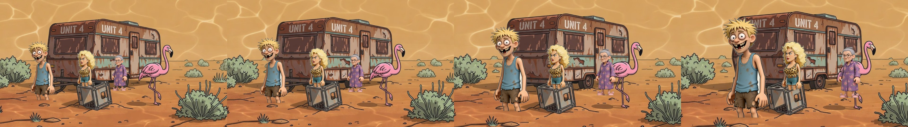

# 2D characters in a Blender scene (step 1)

Question: do we have to build 3D characters? Answer from this test: no. The
real pictures can stand on flat cards at different distances, and Blender's
camera does the rest.

Script: `tools/blender/cutout_scene.py` (about 3 minutes for 96 frames on four
cores, CPU, no credits). Pictures it uses are in `tools/blender/assets/sunnybanks/`.
Video: [cutout-scene.mp4](video/cutout-scene.mp4).

## What was done (Confirmed, we ran it)

1. Took the approved cast pictures (Dazza, Nan, Shazza) from the deck app and
   removed the plain background with a simple colour key (works on these
   pictures; Shazza's blonde hair needed a tighter setting).
2. Put the Park Site 4 location picture far back on a big card.
3. Stood Dazza (near), Nan (middle) and Shazza (far) on cards at different
   distances, with a soft shadow under each.
4. Moved the camera forward and slightly sideways over 4 seconds.

Result: Dazza grows and slides across, Nan passes behind the flamingo, and the
caravan hardly moves. That is real depth, from flat pictures. Three characters
are in one shot.

## Fixes after the first look (2026-10-21)

- Dazza's legs were cut off at the bottom as the camera came close. The camera now ends further back and lower, so his feet stay in frame.
- Nan, Nuggets and Dazza had solid patches left between their legs from the colour key. Large enclosed gaps are now removed; Nan's gap was cleaned by hand.

## What is wrong or unproven

- Everyone faces forward and stays stiff. They only "breathe". They do not
  walk, turn or talk.
- The location is one flat picture, so it cannot show true perspective change
  (the crate and caravan look painted on). Fine for small moves, not big ones.
- Characters do not match the picture's perspective or lighting; they look
  pasted in. Shadows are a simple blob.
- The cut-out edge is a colour key, so hair edges can look slightly rough.
- Lip sync is not tested here (see below).

## What this means for lip sync

Each character is their own card, so each could have their own mouth. The
untested idea: cut the mouth out of each character's picture and swap in mouth
pictures on cue (what the Engine does for 2D already). That is the next step.
