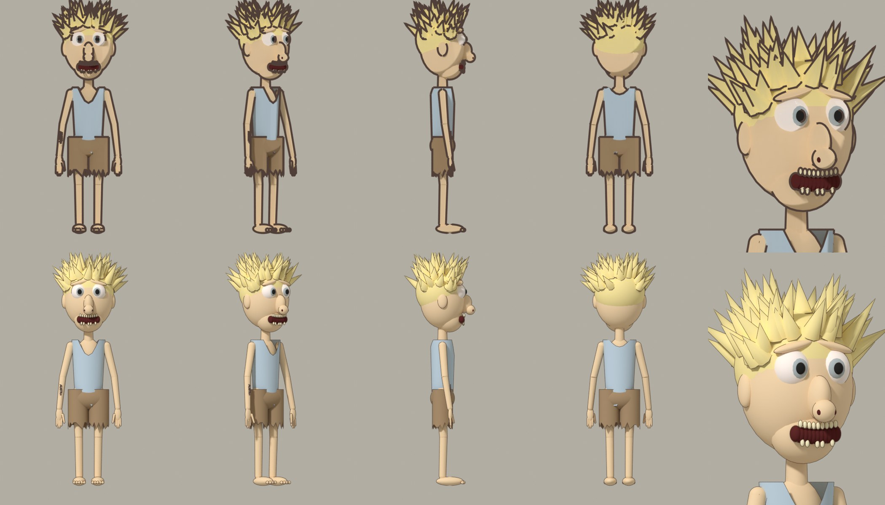

# Dazza in Blender, version 1

First try at turning one Sunny Banks character into a 3D model, from his model
sheet (the sheet is in PR #135 as `images/sunnybanks/sheet-dazza.jpg`).

Script: `tools/blender/dazza.py`. Run on the PC with:

```
& "C:\Program Files\Blender Foundation\Blender 5.2\blender.exe" -b -P tools/blender/dazza.py -- --out renders/dazza
```

It writes the pictures, `dazza_sheet.png` and `dazza.blend` (open that in
Blender to turn him around). Takes about 35 seconds on four cores.



## What it is

Built entirely from simple shapes (spheres, cones, tubes), no sculpting, no
rig yet. Skinny build, wild spiky blonde hair, bulging eyes, big nose,
gap-toothed grin, faded-blue singlet, torn brown shorts, bare feet, "AUSTRALIA"
tattoo on his right forearm. He holds nothing (the sheet's rocket launcher is
left out on purpose).

Two looks from the same model: **cel** (flat bands of colour, thick outline,
the bible's look) and **soft** (smoother shading, thin outline, closer to the
"realistic cartoon" idea).

## Honest assessment (Confirmed by looking at the render)

- Reads as the same character: hair, singlet, shorts, thin limbs, bare feet.
- Rougher than the sheet: no skin texture, dirt, stains or stubble; the face is
  stiff; the hands and feet are blobs; the mouth is a dark shape with small
  teeth, not a drawn grin; hair spikes are all one size.
- The tattoo is tiny and barely readable.
- The look decision (flat cel or realistic cartoon) is still open. This shows
  both side by side so it can be made by eye.

## Next steps (not done)

1. Tidy the face and hair to match the sheet better.
2. Give him a skeleton so he can pose and walk.
3. Mouth shapes (shape keys) for lip sync, then drive them from Rhubarb cues.
4. Place him in a caravan park scene.
