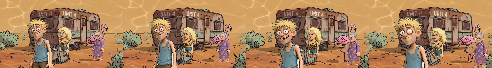
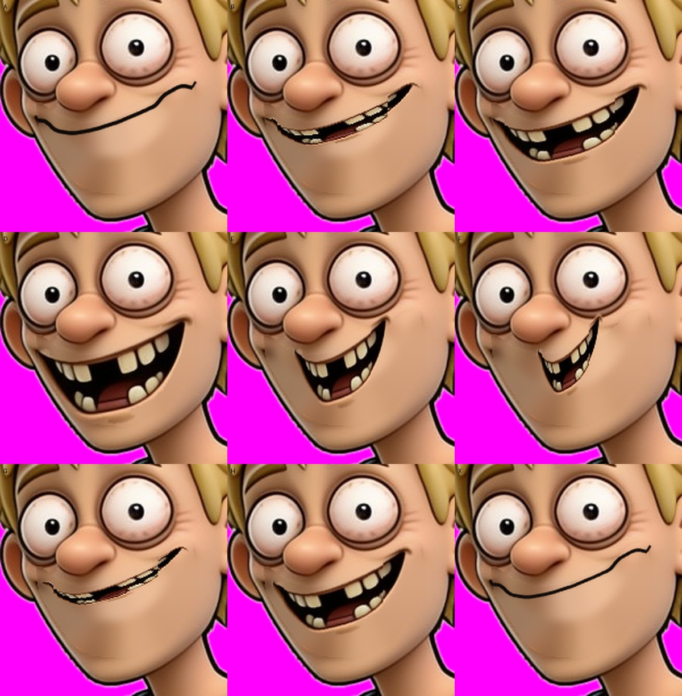

# Dazza talks (step 2)

Question: can one character talk inside the Blender cut-out scene, with the
mouth following the audio? Yes, in a first rough version.

Video: [dazza-talks.mp4](video/dazza-talks.mp4) (2.6 seconds, with sound).
Dazza says his EP01 line "These are pants, Shaz. They cover the essentials."
The audio is from the deck's own render of that line (Act I, beat 19).

## How it works (Confirmed, we ran it)

1. **Audio to mouth shapes.** Rhubarb Lip Sync (v1.14.0, free) listened to the
   audio and gave a list of mouth shapes with times (A to H, and X for rest).
   The line used 7 of the 9 shapes. The list is `dazza_pants_cues.json`.
2. **Dazza without his grin.** His approved picture has a big open grin, so
   `tools/blender/make_dazza_mouths.py` paints it out (`dazza-nomouth.png`).
3. **Nine mouths from his own grin.** (Version 2.) The same script cuts his
   real grin out of the picture and squeezes it to different heights, and
   narrower for the "oh" and "oo" shapes, so the teeth, gap, tongue and
   shading are his own art. The closed shapes are a line along his top lip.
   They go in a 3x3 sheet (`dazza-mouths.png`, shown below). Version 1 had
   mouths drawn with code; they looked flat and did not match him.
4. **Swap on cue.** `tools/blender/talk_scene.py` puts the mouth sheet on a
   small card just in front of his face and, at each cue time, moves it to the
   right square. Nan and Shazza stand and breathe as before.
5. **Sound.** ffmpeg joins the audio to the frames.

Order: A B C, D E F, G H X.

## How to fix a mouth by hand (no Blender needed)

The mouths live in one picture, `tools/blender/assets/sunnybanks/dazza-mouths.png`,
a 3x3 sheet with transparent background. Each square is one mouth in the order
above. To change one:

1. Open the file in any paint program (Paint.NET, Krita or GIMP are free).
2. Redraw or edit that square. Keep the same square size and stay inside it.
3. Save over the file with the transparent background kept (PNG).
4. Run `talk_scene.py` again. It uses the file as it is.

Do not re-run `make_dazza_mouths.py` after hand edits, because it rebuilds the
whole sheet and would overwrite them. `dazza-mouth-preview.png` (made by that
script) shows all nine on his face for checking.

Run (needs the audio and cues, both in `tools/blender/assets/sunnybanks/`):
`blender -b -P tools/blender/talk_scene.py -- --out renders/talk`
About 2.5 minutes on four cores. To use another line, get its cues with
Rhubarb (`rhubarb -f json -o cues.json --dialogFile line.txt line.wav`) and
pass `--audio` and `--cues`.

## What is wrong or unproven

- The open mouths are one grin squashed, so teeth look a bit thin when the
  mouth is nearly shut and "oo" is just a narrow grin, not pursed lips.
- A and X (closed) look almost the same, and the closed mouth is only a line.
- His head does not move, tilt or nod while talking, and his eyes do not blink.
  Talking looks stiff.
- Only one angle: the mouths fit his face as drawn (slightly turned). A big
  camera turn would show the trick.
- The patch where his grin was painted out is a little blurry up close.
- Only Dazza has a mouth set. Each new character needs their own.
- Rhubarb mouth timing is rough. Check it by eye and fix cue times by hand.
- Several characters talking at once is possible (each has their own card and
  their own cues) but not tested.
- Rhubarb is not part of the repo; the Engine runs it if installed (see
  `worker/python/compositor/lipsync.py`).
