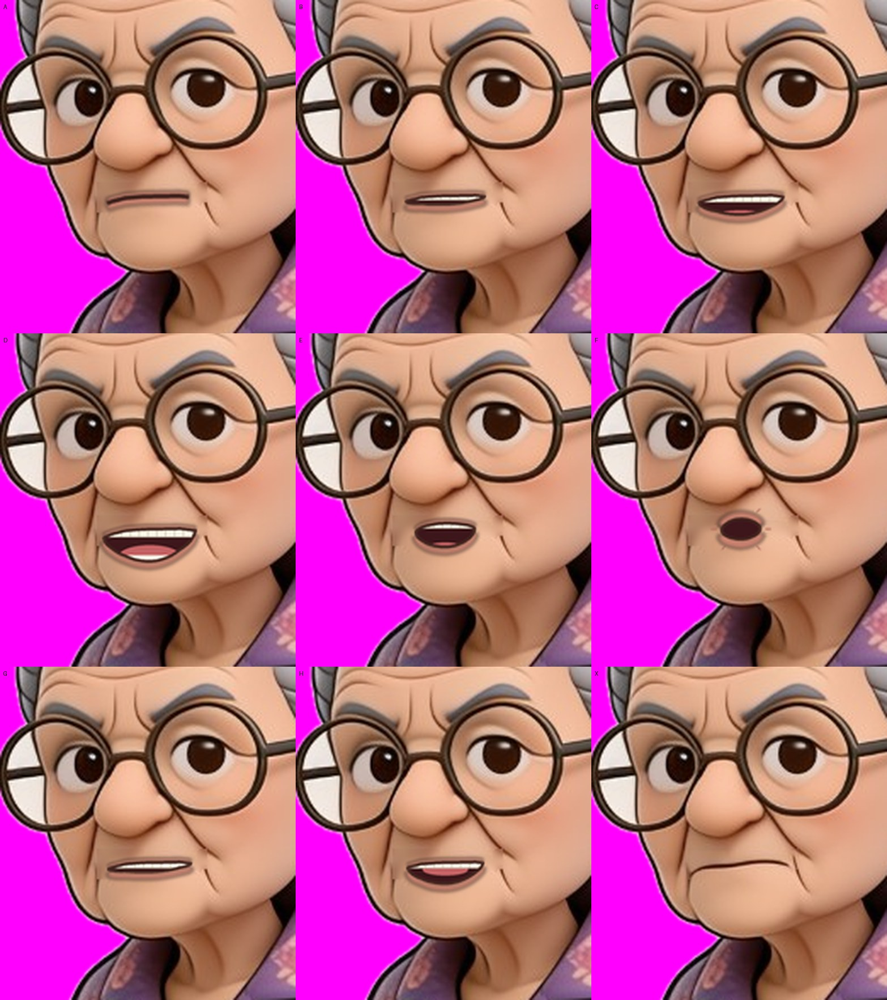
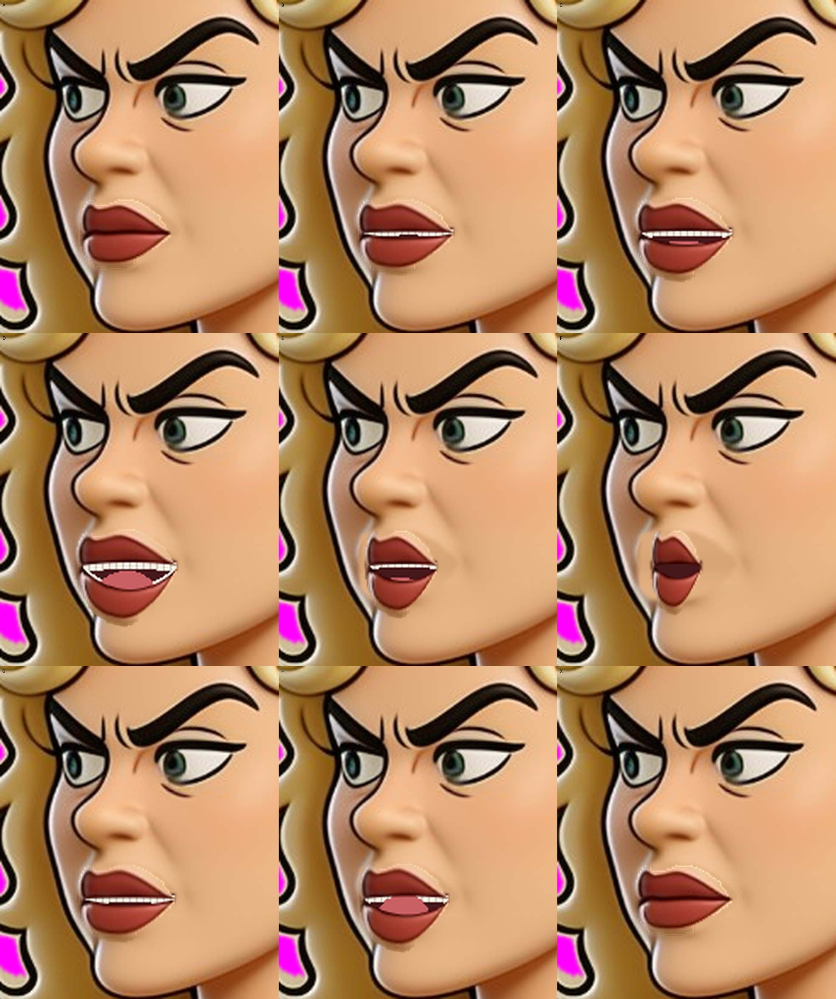

# Characters talking (Dazza, Nan, Shazza)

**Question:** can more than one character talk in the same shot?
**Short answer:** yes, in this first version they take turns (one speaks, the
other stands and breathes). Rendered on the user's PC (960x540, about 4 min
for 6.5 s); first test videos are in `pc-test/`.

## How it works

- Every speaker has their own picture with the mouth painted out, their own
  sheet of nine mouths and their own Rhubarb cues file.
- `tools/blender/dialogue_scene.py` reads a list of lines (who, audio, cues,
  optional start time), swaps each speaker's mouth on cue, pushes the camera in
  on whoever is talking, and mixes all the audio into one track with ffmpeg.
- The default run uses two short test lines made with the user's own
  ElevenLabs voices (the locked "Dazza" and "Sunny Banks Nan" voices; the
  cloud assistant's ElevenLabs key can read the voice list and make speech):
  Dazza: "Gday Nan. Reckon I've finally fixed your tap." Nan: "You've fixed
  nothing, Dazza. There's water in me slippers." They are invented for the test,
  not from a script. Audio and text are in `tools/blender/assets/sunnybanks/`
  (`dazza_tap`, `nan_tap`), with Rhubarb cues made from the text.

## Nan's mouths

Dazza had a big grin to squash into other shapes. Nan has a thin, closed,
grumpy mouth, so her open mouths are drawn (`tools/blender/make_nan_mouths.py`):
a lens shape along her own mouth line (same tilt and frown), a thin lip
outline, pale lip band, dentures and tongue. X is her own mouth line cut out
of her picture, and A is the same line with lips pressed together.



Hand-fixing works the same as for Dazza: edit a square in
`tools/blender/assets/sunnybanks/nan-mouths.png` and do not re-run the script.

## Run it (Windows)

```
& "C:\Program Files\Blender Foundation\Blender 5.2\blender.exe" -b -P tools\blender\dialogue_scene.py -- --out renders\dialogue --width 640 --height 360 --samples 8
```

Other lines: make a small lines file (see the top of `dialogue_scene.py`), run
Rhubarb on each wav with the line text as `--dialogFile`, and pass `--lines`.

## Known limits

- Turn-taking only. The listener does not react yet.
- Nan's drawn mouths are simpler than Dazza's (his are his own teeth). Her chin
  does not drop when she opens up.
- The old "one character per speaking shot" rule in the deck came from LTX
  limits (one person on screen, lip-sync swapping characters). The user has
  confirmed it does not apply here.

## Shazza's mouths and EP01 Act I Scene 1

Shazza faces left, three-quarter view, with closed red lips. Like Dazza's, her
mouths are made from her own picture (`tools/blender/make_shazza_mouths.py`):
her lips are split along the line between them, the upper lip stays, the lower
lip drops by different amounts (less toward the corners, so the gap is
lens-shaped), and a dark mouth with teeth and tongue is painted in the gap. The
lips are cut to her outline so they never stick out past her face.



`tools/blender/assets/sunnybanks/ep01_scene1/` holds the first real script
scene: EP01 Act I Scene 1 (the demountable site office), the nine speaking
lines of Shazza, Dazza and Nan, made with the user's own ElevenLabs voices
(`lines.txt` has the text; each line has a wav, its text and Rhubarb cues).
`lines.json` sets the location picture (`office-storefront.jpg`) and where
the three stand. Run:

```
& "C:\Program Files\Blender Foundation\Blender 5.2\blender.exe" -b -P tools\blender\dialogue_scene.py -- --lines tools\blender\assets\sunnybanks\ep01_scene1\lines.json --out renders\ep01s1 --width 640 --height 360 --samples 8
```

About 35 seconds of video, so about 840 frames: allow roughly 10 minutes at
640x360 and about 20 at 960x540. Use `--still N` (frame number) to check one
frame in seconds. Frame times: Shazza starts at 0.5 s, Dazza at 8.9 s, Shazza
again at 15.0 s, Dazza at 22.5 s, Nan at 26.1 s.

Not from the script (left out for now): the stage directions (arms crossed,
cigarette, Nan knitting in a lawn chair), the closing Shazza line after the
Hans cut, and Hans. The script says "alone nearest camera" for every
speaking shot (the old LTX single-person rule, which the user has said does not
apply here), so this version uses one wide shot of all three and a close-up
on whoever talks.
