# Blender showcase: what we can make

A picture gallery of what Blender, driven by scripts and Cursor, can already make
for us. Every picture below was built entirely by script
(`tools/blender/showcase.py`), with no downloaded models or textures, so each one
can be rerun, changed and reused.

**Be clear about what this is:** a set of first drafts made in one session to show
range. They are not finished art. Some look rough and some need more work, and the
notes under each picture say so. The point is that every one of these facets exists
and works through a script, so we are not limited by not knowing what is possible.

Rendered on the assistant's Linux machine (4 CPU cores, no graphics card), Cycles,
960x540, 48 samples, Blender 5.2.2 LTS. Not yet run on the user's PC. Status words
as in the [README](README.md).

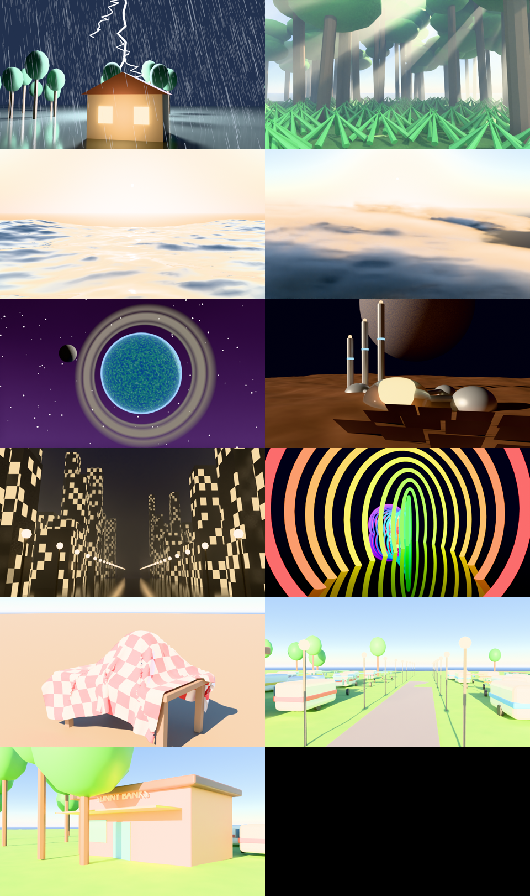

## Run it

```
& "C:\Program Files\Blender Foundation\Blender 5.2\blender.exe" -b -P tools\blender\showcase.py -- --out renders\showcase
```

Options: `--list`, `--only storm,ocean`, `--width 1920 --height 1080`,
`--samples 96`. A full run took about 8 minutes on the assistant's machine
(timings below). Add scenes by writing one function and listing it in `SCENES`.

## The pictures

Times are the assistant's machine at 960x540, 48 samples.

### Rain and lightning (storm) - 11 s

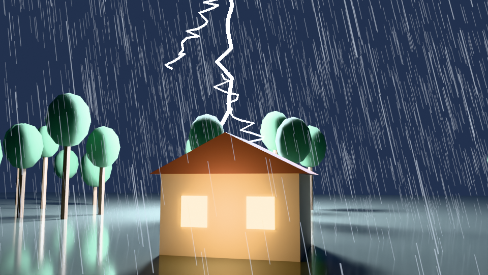

A farmhouse at night, thousands of rain streaks, a jagged lightning bolt that also
lights the scene. Status: **Confirmed** (looked at). Rain is a single mesh of thin
glowing streaks and the bolt is a bevelled curve plus a very bright light: it is a
fast fake, not a weather simulation. Good for stylised storms. The rain does not
move yet; a moving version needs the streaks animated or a particle system.

### Rainforest with mist and light shafts (rainforest) - 80 s

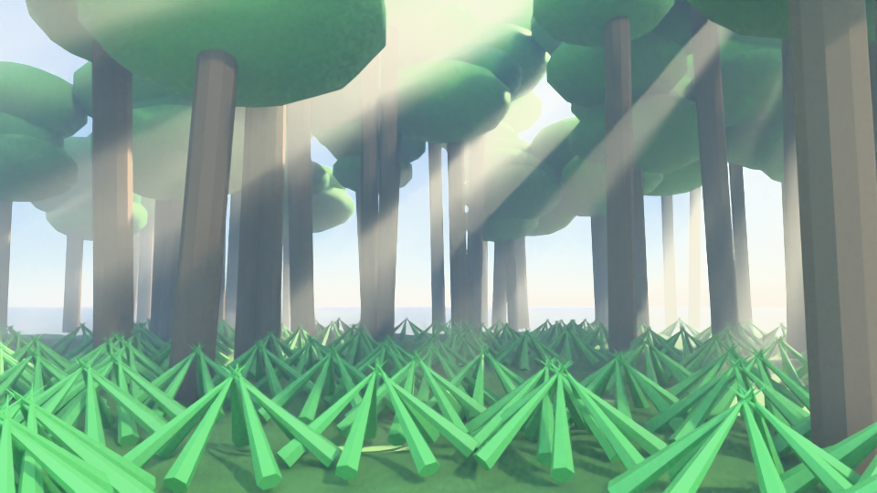

Trunks, layered canopies, ferns, a mossy floor, and sun shafts through a volume of
fog. Status: **Confirmed**, with rough parts. The ferns are plain spikes and the
canopies are blobs. A real rainforest needs better plants (from an asset library or
a Geometry Nodes leaf generator) and more layers of detail.

### Ocean waves at sunset (ocean) - 9 s

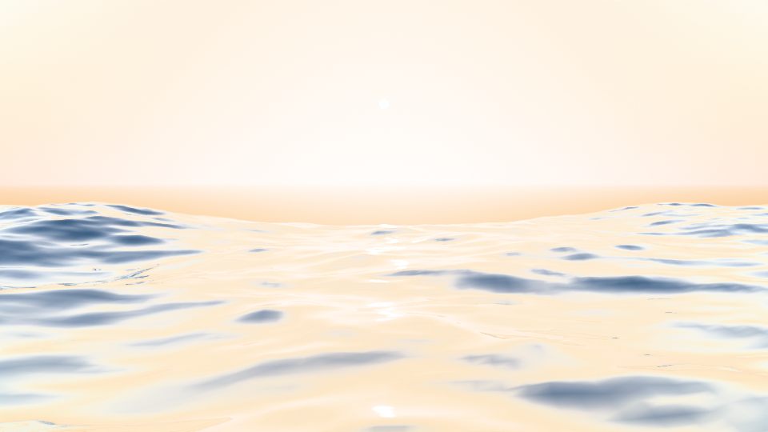

Blender's built-in Ocean modifier drives real wave heights, with a physical sky and
sun glitter. Status: **Confirmed**, washed out. The sky and sea are too pale and
the horizon is plain; it needs foam, colour work and a subject. The waves can be
animated by changing the modifier's time.

### Cloud banks (clouds) - 214 s

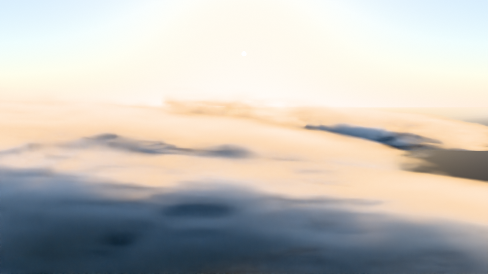

Volumetric clouds from noise inside boxes, lit by a low sun. Status: **Ran, needs
work**. It looks like soft fog layers, not towering clouds, and it was the slowest
scene. Volumes are expensive; this is where a game-engine-style fake or a
pre-made cloud pack may serve better.

### Ringed planet, moon, nebula, stars (planet) - 30 s

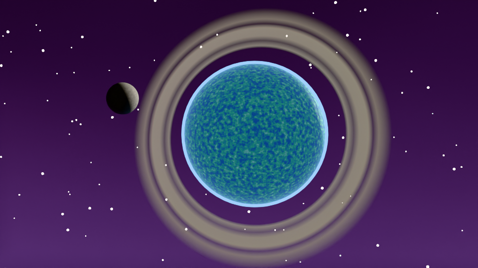

A procedural planet with an atmosphere glow, banded rings, a moon, scattered stars
and a faint coloured nebula. Status: **Confirmed**, first draft. The planet surface
is noisy and the purple background is heavy. Rings and the atmosphere edge glow
work well.

### Off-world base (scifi_base) - 12 s

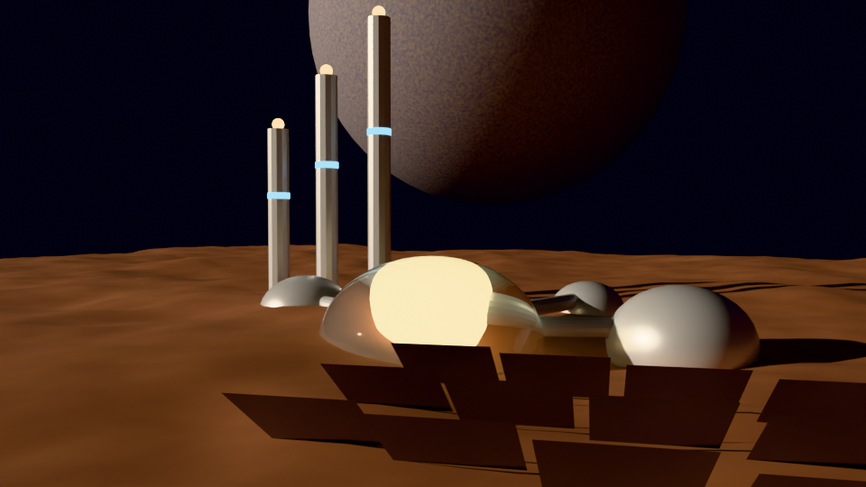

Domes, a hub, tubes, towers with beacons, solar panels, red rocky terrain and a huge
planet in the sky. Status: **Confirmed**, rough. The shapes and mood work; the
domes glow too hot and the panels are plain. Good for a quick blockout of a
science-fiction location.

### City at night (city_night) - 52 s

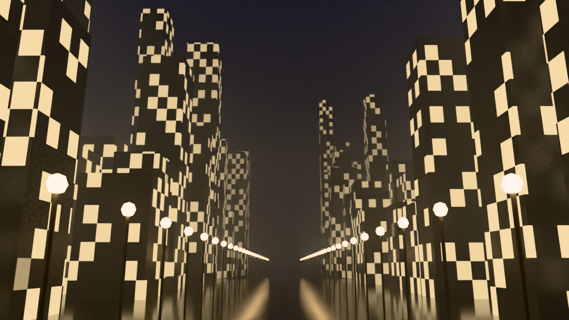

Close to two hundred towers made by a loop, with windows that are procedural (regular grid,
random lights on or off), street lamps and haze. Status: **Confirmed**, first
draft. The windows read as a city but the colours are flat and cream; needs
variation (blue offices, signs, traffic) and bigger variety of buildings.

### Psychedelic ring tunnel (psychedelic) - 11 s

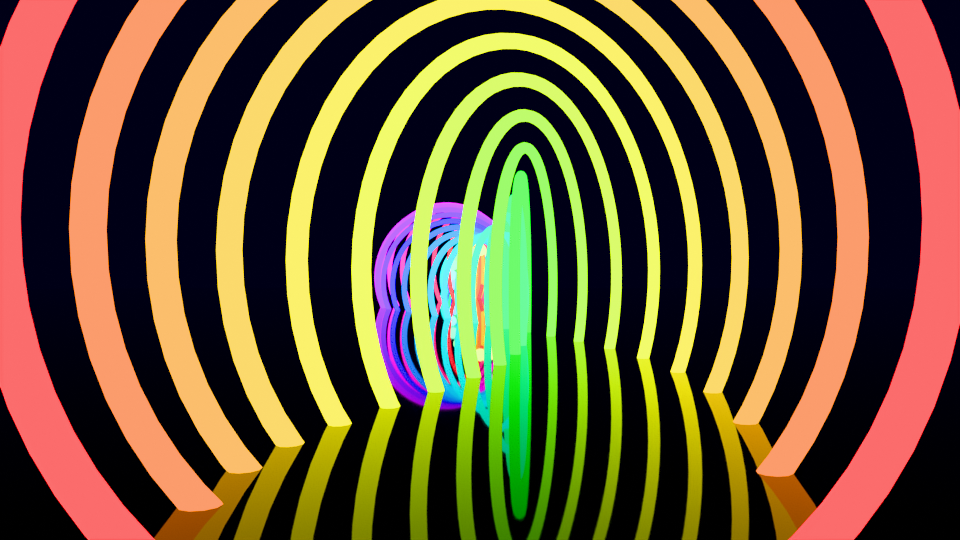

Forty-six rainbow glowing rings in a spiral, glowing orbs, a mirror floor. Status:
**Confirmed**. This is the easiest kind of look to get: colours from a loop, glowing
materials, reflections. Good for music videos and dream sequences.

### Cloth physics (cloth_physics) - 18 s

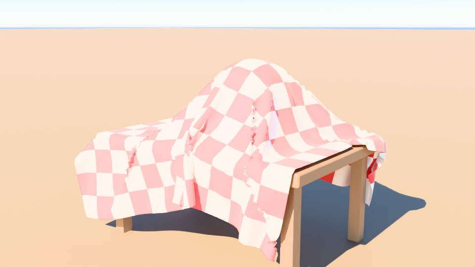

A checked tablecloth dropped over a table and a ball, simulated by script for 70
frames. Status: **Confirmed**. The cloth drapes and folds around the ball. The floor
is a flat orange wash from the sky; needs lighting work. The same simulation system
could drive capes, flags and curtains.

### Sunny Banks caravan park, first draft (caravan_park, caravan_shop) - 15 s and 22 s

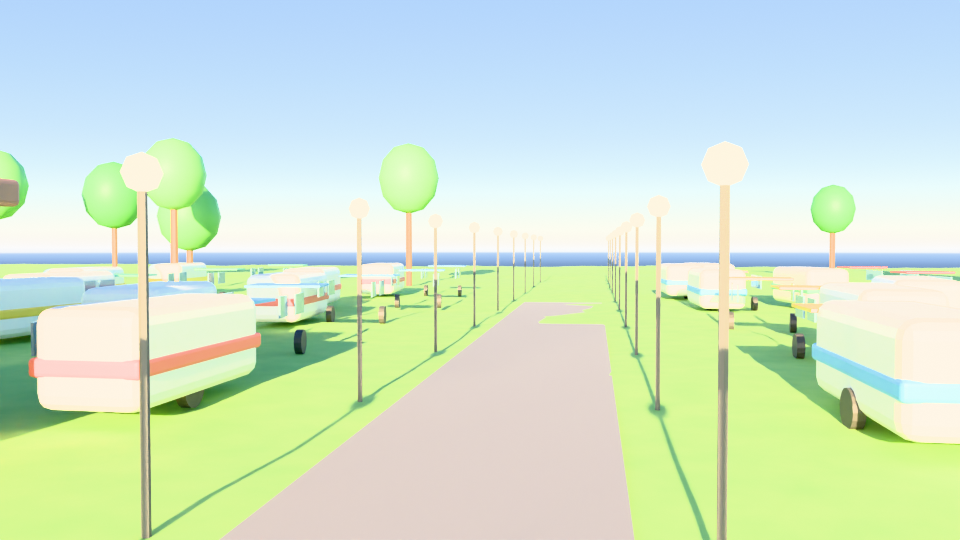

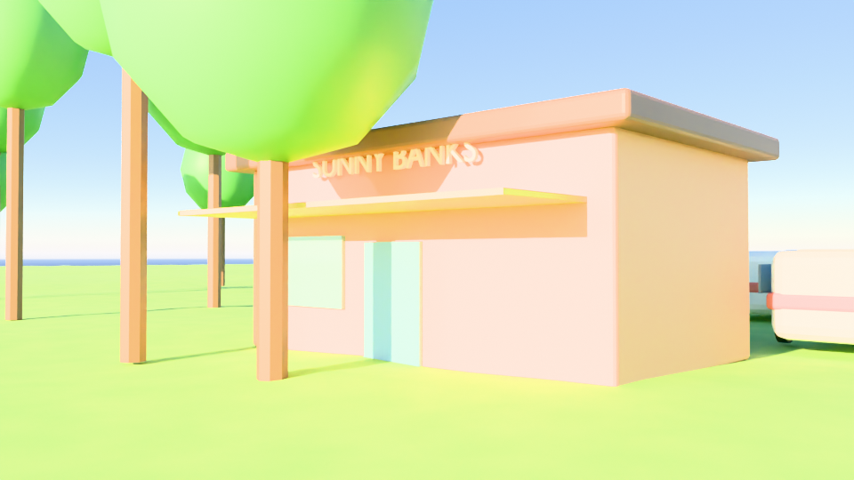

Twenty caravans in rows with coloured stripes, windows, wheels and awnings, a road,
lamp posts, trees, a shop with a "SUNNY BANKS" sign and a park sign, golden-hour
light. Status: **Confirmed**, blockout only. This is the first sketch of the EP06
location, to prove we can build and light a whole park and look at it from more than
one angle. It is washed out, the caravans are plain boxes, and one tree sits in front
of the shop in the second view. It is **not** the real park layout: we still need
the user's description of it.

## Not shown yet, but known to exist in Blender

These are on the checklist in [blender-capabilities.md](blender-capabilities.md) as
Known, not tried: smoke, fire and explosions, water splashes and fluid, fur and
hair on characters, destruction and shattering, volumetric light beams, crowds,
car and vehicle rigs, animated characters with faces, particle effects like sparks
and leaves, snow and sand, procedural buildings, terrain erosion, and sculpted
organic models. Add each one to the showcase with a script when we try it.

## What these tell us

- **Range:** one tool and one scripting route covers natural scenes, space, cities,
  abstract looks and physics. The ideas in the user's list (rain and lightning,
  rainforests, oceans, clouds, planets, cosmos, cities, off-world buildings,
  psychedelic) all have a working first draft above.
- **Time:** most scenes took seconds to a couple of minutes for one still on four
  CPU cores. Volumes (clouds, fog) cost the most. Video means hundreds of times
  that, so stills and short clips come first.
- **Quality:** first drafts are plain. A good look comes from iteration (lighting,
  colour, detail, textures), real asset libraries, and possibly an AI restyle like
  the Grok test, not from the first script.
- **Connection to the show:** the caravan park draft and the rest show that
  locations for EP06 can be built here. How to put characters into them is the open
  question in [sunny-banks-ep06-plan.md](sunny-banks-ep06-plan.md).
